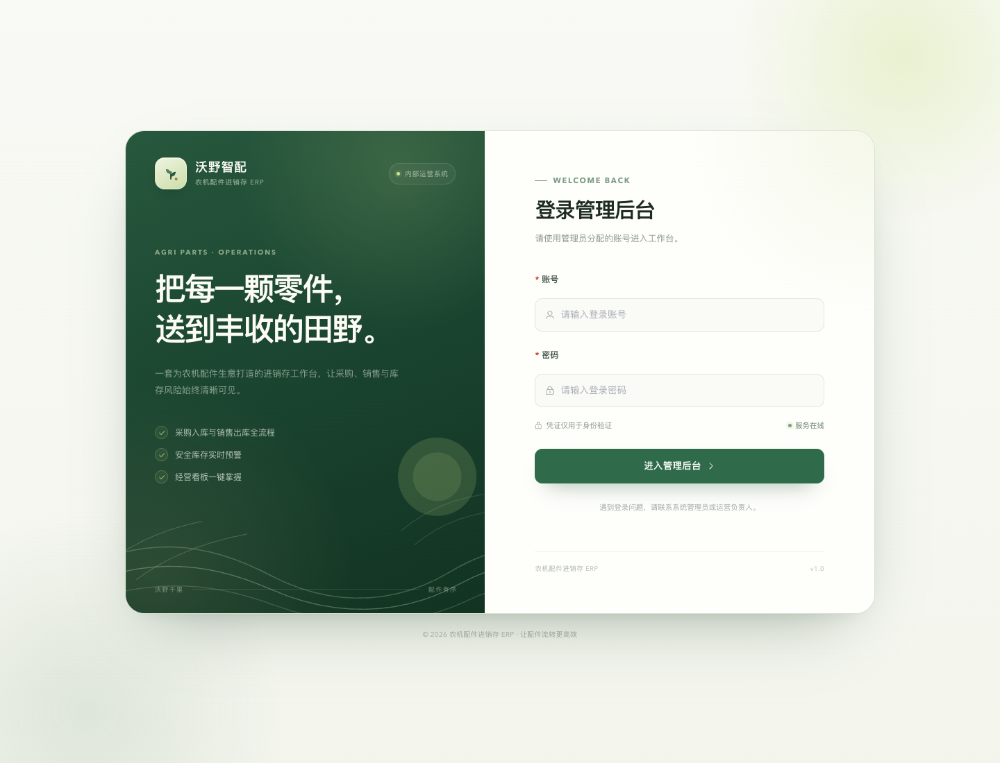
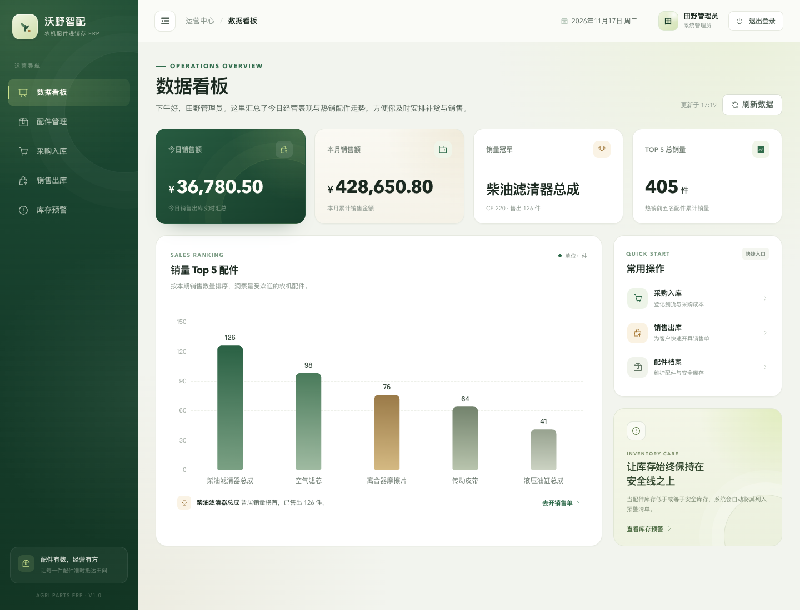
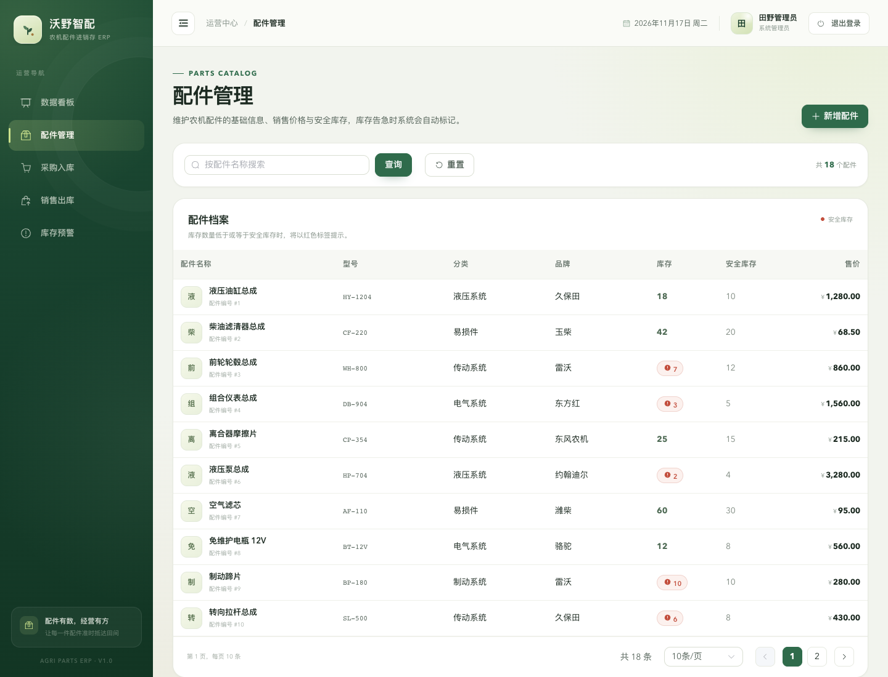
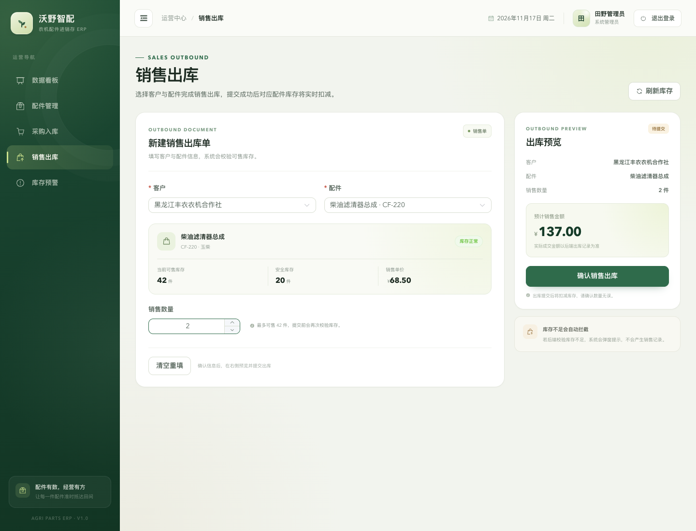

# 农机配件进销存 ERP

基于 **Vue 3 (Composition API) + Vite + Element Plus + Vue Router + Axios + ECharts** 的后台管理系统，覆盖数据看板、配件档案、采购入库、销售出库与库存预警。

## 界面预览

| 登录 | 数据看板 |
| --- | --- |
|  |  |

| 配件管理 | 销售出库 |
| --- | --- |
|  |  |

> 预览图为演示数据。

## 快速开始

环境要求：Node.js >= 20.19（推荐 22+），npm 10+。

```bash
# 安装依赖
npm install

# 启动开发服务器，默认 http://localhost:5173
npm run dev

# 生产构建
npm run build

# 本地预览构建产物
npm run preview
```

后端服务需运行在 `http://127.0.0.1:8000`。

## 路由

| 路径 | 页面 | 说明 |
| --- | --- | --- |
| `/login` | 登录 | 账号密码登录，Token 存入 localStorage |
| `/dashboard` | 数据看板 | 今日/本月销售额 + 销量 Top 5 图表 |
| `/parts` | 配件管理 | 名称搜索、分页、新增、低库存红色高亮 |
| `/purchase` | 采购入库 | 供应商选择、动态多条明细、采购汇总 |
| `/sale` | 销售出库 | 客户与配件选择、库存校验、出库预览 |
| `/warning` | 库存预警 | 库存 ≤ 安全库存的配件清单 |

路由守卫会拦截未登录访问，并将已登录用户访问 `/login` 时重定向到 `/dashboard`。

## 接口约定

Axios 实例位于 `src/utils/request.js`，`baseURL` 固定为：

```js
http://127.0.0.1:8000/api/v1
```

### 1. 登录

```http
POST /auth/login
Content-Type: application/json

{ "username": "admin", "password": "123456" }
```

成功响应（Token 也兼容 `access_token` / `accessToken`）：

```json
{
  "code": 200,
  "data": {
    "token": "your-jwt-token",
    "user": {
      "username": "admin",
      "name": "田野管理员",
      "role_name": "系统管理员"
    }
  }
}
```

登录成功后 Token 存入 `agri_erp_token`，之后请求自动携带：

```http
Authorization: Bearer <token>
```

### 2. 数据看板

```http
GET /dashboard
```

```json
{
  "code": 200,
  "data": {
    "today_sales": 36780.5,
    "month_sales": 428650.8,
    "top_parts": [
      { "part_id": 2, "name": "柴油滤清器总成", "model": "CF-220", "quantity": 126 }
    ]
  }
}
```

销量列表字段也兼容 `top5`、`top_products`、`sales_top5` 等命名，最多取前 5 条。

### 3. 配件

```http
GET /parts?page=1&page_size=10&name=滤清器
```

```json
{
  "code": 200,
  "data": {
    "items": [
      {
        "id": 1,
        "name": "柴油滤清器总成",
        "model": "CF-220",
        "category": "易损件",
        "brand": "玉柴",
        "stock": 42,
        "safe_stock": 20,
        "price": 68.5
      }
    ],
    "total": 18
  }
}
```

新增配件：

```http
POST /parts
Content-Type: application/json

{
  "name": "液压油缸总成",
  "model": "HY-1204",
  "category": "液压系统",
  "brand": "久保田",
  "stock": 18,
  "safe_stock": 10,
  "price": 1280
}
```

### 4. 库存预警

```http
GET /parts/warning
```

返回结构与配件列表一致，也兼容直接返回数组。

### 5. 供应商与客户

> 需求未指定这两个基础资料接口，前端暂按以下路径接入。若后端路径不同，只需修改
> `src/api/suppliers.js` 和 `src/api/customers.js`。

```http
GET /suppliers
GET /customers
```

```json
{
  "code": 200,
  "data": {
    "items": [
      { "id": 1, "name": "华北农机配件中心", "contact": "王经理" }
    ]
  }
}
```

### 6. 采购入库

```http
POST /purchases/inbound
Content-Type: application/json

{
  "supplier_id": 1,
  "items": [
    { "part_id": 2, "quantity": 10, "unit_price": 60 }
  ]
}
```

### 7. 销售出库

```http
POST /sales/outbound
Content-Type: application/json

{
  "customer_id": 2,
  "part_id": 2,
  "quantity": 3
}
```

库存不足请返回非 2xx 状态码，或业务失败 `code`，并将提示写入 `message` / `msg` / `detail`：

```json
{
  "code": 400,
  "message": "库存不足：当前仅剩 1 件"
}
```

前端识别到“库存”相关错误时会弹出错误弹窗；其他错误统一由响应拦截器处理。

### 响应与错误规范

- HTTP 状态码 2xx，且业务 `code` 为 `0` / `2xx` 视为成功。
- 兼容 `message`、`msg`、`detail`（FastAPI 校验错误数组）作为错误文案。
- 任意接口返回 HTTP 401 或业务 `code: 401` 时，会清除本地登录态并跳转登录页。
- 业务错误已在拦截器中统一提示，页面仅需处理加载状态与特殊交互。

## 跨域配置

由于 Axios 按要求直接请求 `http://127.0.0.1:8000`，前后端属于跨域，需要后端允许
`http://localhost:5173` / `http://127.0.0.1:5173`。FastAPI 示例：

```python
from fastapi.middleware.cors import CORSMiddleware

app.add_middleware(
    CORSMiddleware,
    allow_origins=[
        "http://localhost:5173",
        "http://127.0.0.1:5173",
    ],
    allow_credentials=True,
    allow_methods=["*"],
    allow_headers=["*"],
)
```

## 目录结构

```text
.
├── docs/screenshots/        # 界面预览图
├── public/favicon.svg
├── src
│   ├── api                  # 登录、看板、配件、采购、销售、供应商/客户
│   ├── components           # 品牌标识、页头、ECharts 图表
│   ├── layout               # Element Plus Container 主框架
│   ├── router
│   ├── styles/main.css      # 设计变量与全局样式
│   ├── utils
│   │   ├── auth.js          # Token / 用户信息存储
│   │   ├── format.js        # 金额、数量、日期格式化
│   │   ├── normalize.js     # 接口字段兼容与归一化
│   │   └── request.js       # Axios 拦截器
│   ├── views                # 6 个业务页面
│   ├── App.vue
│   └── main.js
├── index.html
├── package.json
└── vite.config.js
```

## 实现要点

- Composition API + `<script setup>`，按 API / 工具 / 组件 / 页面分层。
- Element Plus Container 布局，侧栏支持桌面折叠与移动端抽屉，顶部 Header 含退出登录。
- 配件库存 `stock <= safe_stock` 时，库存列使用红色 `el-tag` 高亮展示。
- 采购单支持最多 20 条动态明细、重复配件拦截、小计与总额实时汇总。
- 销售页对库存做前端预校验，并处理后端“库存不足”专属弹窗；出库成功后刷新配件库存。
- ECharts 采用按需引入（BarChart / Grid / Tooltip / Aria / Canvas），支持容器自适应。
- 已完成 `npm run build` 生产构建与核心流程自动化冒烟测试。
